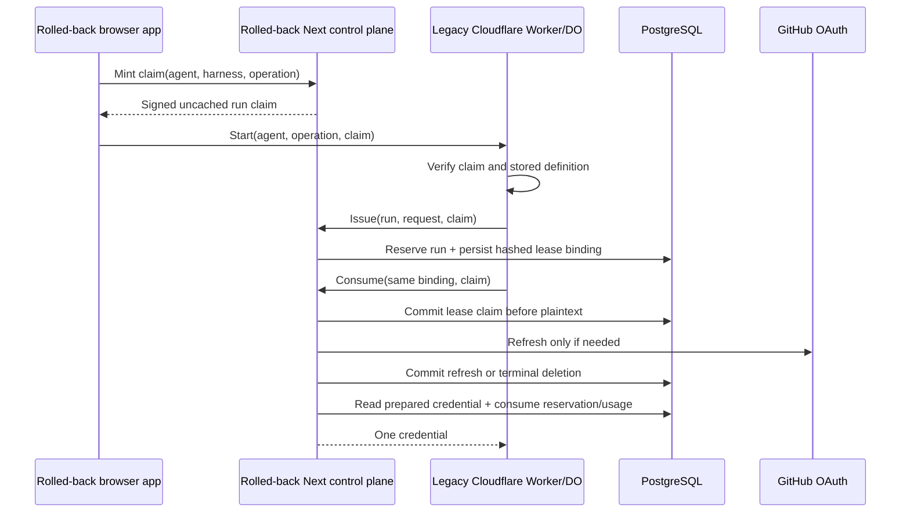

# Execution Threat Model

- Status: living document
- Owner: Security & privacy workstream
- Companion to: [Security incident response](incident-response.md), which
  covers what to do once one of these threats has occurred
- Applies to: control plane, shared contracts, cloud runner, guest publication,
  and operator credentials

## Scope and security goals

Coven Agents intentionally launches coding harnesses with approval prompts
disabled. The security boundary is therefore not "the model cannot execute a
dangerous command." The boundary is which identity may request execution, which
workspace and tenant receive it, which credentials enter it, what evidence may
leave it, and how much work may be consumed.

This model covers:

- the Next.js control plane and its database;
- the shared contracts and evidence normalization package;
- the still-deployed Cloudflare Worker, Durable Objects, and sandbox containers
  as a rollback runtime;
- operator, deployment, tenant, and harness credentials;
- committed guest-preview evidence and source-control boundaries.

Security goals:

1. A caller cannot act as another tenant or access another tenant's agent,
   sandbox, credential, run, or database state.
2. Guest and unsubscribed identities cannot obtain subscriber execution or
   persistence authority.
3. Harness credentials remain under tenant ownership, are encrypted at rest,
   and are exposed only to the intended run.
4. Cloud execution stays inside its tenant sandbox; local execution is clearly
   disclosed as trusted-host execution until optional local isolation exists.
5. Secret-like output and local machine details are removed before supported
   persistence, publication, or user-visible evidence boundaries.
6. Input, output, execution time, and repeated work are bounded or have an
   explicit roadmap control.
7. Missing identity, keys, configuration, or authority fails closed.

Out of scope:

- the internal security of GitHub, Cloudflare, Stripe, or a model provider;
- preventing an authorized harness from changing files inside its granted
  workspace;
- treating natural-language prompts as trusted instructions;
- operating-system isolation beyond the per-agent sandbox container.

## Actors and assumptions

Relevant actors:

- an unauthenticated internet client probing public routes;
- an authenticated guest account with no execution entitlement;
- a subscriber acting within their own tenant;
- a malicious tenant attempting cross-tenant access or resource exhaustion;
- a compromised browser, extension, local process, or website;
- an untrusted repository, task prompt, dependency, harness, or harness output;
- an operator deploying the control plane and Daytona runner while retaining
  the rollback Worker, public verification keys, and service tokens;
- GitHub, Cloudflare, Stripe, and harness providers outside this repository.

Assumptions:

- production browser traffic uses HTTPS and deployment secrets are supplied
  through platform secret stores, not committed configuration;
- Cloudflare enforces its documented Worker, Durable Object, and sandbox
  isolation properties while the rollback runtime remains deployed;
- the control-plane runtime and database are not shared with untrusted tenant
  processes;
- the local operator controls the host account and understands that a locally
  launched harness receives that account's authority;
- GitHub authentication proves control of the GitHub identity, while Coven's
  server-owned state remains authoritative for product entitlement;
- provider credentials may be revoked outside Coven and should be treated as
  exposed after a relevant process, host, or storage compromise.

## System and data flow

1. A browser authenticates to the control plane with GitHub. The control plane
   derives product identity and entitlement; GitHub profile data is not runner
   authority.
2. An eligible subscriber calls the same-origin agent and run APIs. The browser
   sends its httpOnly Auth.js application session cookie and no runner endpoint,
   deployment credential, or signed runner identity.
3. The control plane revalidates subscriber authority against server-owned
   state, derives the tenant from the authenticated account, checks ownership
   and abuse policy, and accepts a browser-generated operation ID only as
   bounded request input.
4. The server-side runner service reserves capacity and dispatches the
   tenant-scoped run to Daytona. Credential lending remains server-only and
   binds the tenant, harness, run, request, and operation before plaintext can
   exist.
5. Daytona injects the tenant's credential into one harness process in one
   sandbox. Normalized, redacted evidence returns through the shared contract
   and same-origin APIs.

The Cloudflare Worker remains deployed only as a rollback runtime. If the
application is rolled back to the legacy browser path, that older application
can provision its deployment gate and signed claims; the Worker then verifies
them and calls the retained internal authority and credential endpoints. The
current application does not mint those claims or expose that browser path.

## Assets

| Asset | Why it matters | Primary custodian |
| --- | --- | --- |
| Application session | Authenticates current same-origin browser requests; server state supplies tenant and entitlement | httpOnly browser cookie and control plane |
| Legacy Worker verification ring | Verifies rollback-only signed claims; public material cannot mint identity | Public keys in control plane and Worker; private signer exists only in a rollback application release |
| Legacy Worker control token | Gates access to the rollback Worker deployment | Control plane configuration and Worker; never the current browser |
| Diagnostic operator token | Runs the rollback Worker's operator-only Sandbox probe | Operator secret store and Worker only |
| Legacy Worker service token | Gates rollback Worker calls to retained internal endpoints | Control plane and Worker |
| Credential KEK ring | Decrypts tenant credential data keys; supports bounded rewrap before retirement | Control plane only |
| Tenant harness credential | Acts as the tenant at a coding provider | Encrypted database row; in-memory run scope |
| Tenant identity and entitlement | Determines persistence and execution authority | Control plane |
| Agent definitions and run evidence | May contain private repository or task context | Tenant-scoped storage and UI |
| Guest replay fixtures | Publicly rendered execution evidence | Repository |
| Roadmap and source history | Can disclose private details or committed credentials | Private repository and private Beads store |

## Trust boundaries

### B1. Browser to control plane

The browser is untrusted input. GitHub authentication establishes a user, but
subscriber authority is recomputed from server-owned subscription state.
`lib/session.ts`, `lib/auth/subscriber-access.ts`, and `lib/db/access.ts`
separate guest (internally `demo`), subscriber, and database authority.
Same-origin agent and run routes authenticate the application session and
re-read the user row before tenant-scoped work, so an operator revocation is
immediate. The browser receives neither a runner connection credential nor a
minted runner identity token.

### B2. Browser to legacy cloud runner (rollback only)

The current browser-to-runner boundary is same-origin and application-session
authenticated; it does not use the Cloudflare Worker. The still-deployed Worker
is retained only for rollback and continues to verify legacy signed claims in
`worker/src/routes.ts`. The app keeps the matching public verification ring for
the Worker-facing internal routes, but no current app module holds the private
signing key or mints claims. CORS remains defense in depth rather than
authentication. `/api/diagnostics/sandbox` remains operator-only through the
separate `OPERATOR_DIAGNOSTIC_TOKEN`.

### B3. Legacy Worker to internal endpoints (rollback only)

The current Daytona path does not use these HTTP endpoints. They remain only so
the deployed rollback Worker can continue operating until its removal PR. The
legacy service token permits the Worker to reach an endpoint but does not choose
a tenant. `app/api/internal/runner-authority/route.ts` accepts only a bounded
body containing the legacy signed token, verifies it against the app's public
current/previous key ring, and derives the subject and tenant from the
authenticated claims before the database lookup. The credential endpoint
independently verifies the forwarded legacy claim, and
`app/api/internal/credential/binding.ts` derives the tenant and requires the
subscriber plan. The control plane checks the current database `authVersion`
before reservation or credential decryption. A body/claim mismatch is refused.
Each rollback Worker run carries a fresh opaque request ID and the harness from
its active agent definition. The rollback application signed that agent,
harness, and operation into the run claim; the Worker and current internal
routes verify the same scope independently. Issuance reserves capacity and
persists HMAC hashes of the operation, request, and tenant alongside the
harness and run. Consumption commits the one-use claim before decrypting. A
binding mismatch and every duplicate, expired, released, or consumed
reservation fail before plaintext exists.



### B4. Control plane database and credential custody

Browser-facing product-data access requires subscriber authority. New paths use
a `SubscriberSession` through `lib/db/access.ts`; legacy chat paths call the
same fail-closed subscriber gate before their query helpers. Guest claims are
rejected without a subscription lookup; signed-in sessions are revalidated
against current server-owned `authVersion`, so revocation does not wait for
token expiry. Narrow account, usage-status, and checkout
paths are documented guest exceptions and expose no chat, document,
credential, agent, or run data. Tenant credentials are scoped by tenant and
harness and sealed before storage in `lib/credentials/store.ts`; each row names
one configured KEK version, and the ring has no default or brute-force
fallback. The internal credential route is the documented service-to-service
exception and replaces the session gate with service and signed-identity
checks. Credential-lease audit events contain only tenant hash, harness ID, run
ID, operation, outcome, and timestamp.

### B5. Worker to Durable Objects and sandboxes

Every cloud operation is filtered by the verified tenant.
`worker/src/tenant.ts` derives unambiguous sandbox keys and rejects unsafe
tenant identifiers. `worker/src/routes.ts` and the directory interface require
tenant-scoped listing and ownership checks.

### B6. Sandbox to external networks

Container isolation exists, but a declared outbound network policy does not.
Cloud egress is therefore a residual risk tracked by `coven-agents-cloud.4`.

### B7. Evidence to storage, UI, guest preview, and Git

`packages/agent-contracts/src/evidence.ts` removes recognized credentials,
sensitive assignments, headers, and explicit run-local secrets. The guest
recorder redacts before schema validation, and `lib/demo/fixtures.test.ts`
checks both raw and canonical JSON. `scripts/secret-scan.ts` scans staged and
tracked Git content without printing matched values.

## Abuse-control policy maxima

`lib/abuse/policy.ts` is the reviewed source of truth for the initial request
maxima below. These declarations define the shared contract only; later
admission and storage tasks enforce them. Every currently declared policy fails
closed, including cost-bearing and resource-bearing routes.

Emergency configuration may lower these limits but must never raise them above
the code maxima. Raising a maximum or changing a subject, body ceiling, window,
or failure mode requires a reviewed code change, shadow telemetry showing the
expected rejection and false-positive rates, and an explicit rollback review
with thresholds chosen before enforcement.

| Route | Subjects | Body bytes | Burst | Sustained | Failure |
| --- | --- | ---: | ---: | ---: | --- |
| `auth_start` | IP | 0 | 5 / 60 s | 20 / 1 h | closed |
| `auth_callback` | IP | 16,384 | 10 / 60 s | 40 / 1 h | closed |
| `chat` | IP, user | 64,000 | 4 / 60 s | 60 / 1 h | closed |
| `chat_delete` | IP, user | 0 | 5 / 60 s | 20 / 1 h | closed |
| `document_read` | IP, user | 0 | 60 / 60 s | 600 / 1 h | closed |
| `document_write` | IP, user | 262,144 | 20 / 60 s | 100 / 1 h | closed |
| `document_delete` | IP, user | 0 | 5 / 60 s | 20 / 1 h | closed |
| `history_read` | IP, user | 0 | 60 / 60 s | 600 / 1 h | closed |
| `history_delete` | IP, user | 0 | 5 / 60 s | 20 / 1 h | closed |
| `messages_read` | IP, user | 0 | 60 / 60 s | 600 / 1 h | closed |
| `suggestions_read` | IP, user | 0 | 60 / 60 s | 600 / 1 h | closed |
| `vote_read` | IP, user | 0 | 60 / 60 s | 600 / 1 h | closed |
| `vote_write` | IP, user | 8,192 | 20 / 60 s | 100 / 1 h | closed |
| `upload` | IP, user | 5,250,000 | 2 / 60 s | 20 / 1 h | closed |
| `checkout` | IP, user | 8,192 | 2 / 5 min | 3 / 1 h | closed |
| `avatar_read` | IP, user | 0 | 60 / 60 s | 600 / 1 h | closed |
| `avatar_write` | IP, user | 8,192 | 10 / 60 s | 40 / 1 h | closed |
| `credential_list` | IP, user | 0 | 30 / 60 s | 200 / 1 h | closed |
| `credential_write` | IP, user | 16,384 | 10 / 60 s | 40 / 1 h | closed |
| `credential_delete` | IP, user | 8,192 | 10 / 60 s | 40 / 1 h | closed |
| `credential_device_start` | IP, user | 0 | 2 / 5 min | 5 / 1 h | closed |
| `credential_device_poll` | IP, user | 8,192 | 12 / 60 s | 60 / 1 h | closed |
| `usage_read` | IP, user | 0 | 60 / 60 s | 600 / 1 h | closed |
| `analytics_read` | IP, user | 0 | 20 / 60 s | 100 / 1 h | closed |
| `model_list` | IP | 0 | 120 / 60 s | 1,200 / 1 h | closed |
| `stripe_webhook` | IP | 262,144 | 60 / 60 s | 600 / 1 h | closed |
| `run_start` | IP, tenant | 64,000 | 5 / 60 s | 25 / 1 day | closed |
| `internal_credential` | IP, tenant | 8,192 | 10 / 60 s | 60 / 1 h | closed |

The repeated low-cost read, standard write, sensitive credential, destructive
write, and webhook values are named shared classes in code so later tuning
cannot leave equivalent surfaces with accidental object-level drift. Route
entries still state their subject set, body ceiling, and selected reviewed
class explicitly.

## Threat register

| ID | Threat and impact | Current controls and verification | Residual risk or follow-up |
| --- | --- | --- | --- |
| T1 | A forged identity reads or mutates another tenant's agents or runs. | Current agent and run routes derive identity from the same-origin application session and enforce tenant ownership. For rollback only, the Worker verifies legacy Ed25519 claims and the retained internal authority and credential routes validate them against the public key ring and current database authority. | Compromise of a private signing key in a rollback application release remains critical until the legacy Worker boundary is removed. |
| T2 | A shared infrastructure token becomes a master tenant credential. | The current browser receives no deployment or service token. In the rollback Worker boundary, the control token gates deployment access only; the internal credential endpoint independently verifies the signed claim, tenant binding, and database `authVersion` before reservation or decryption. | Browser compromise can use the current user's application session until revocation. Legacy runner claims remain bounded by expiry when the rollback runtime is active. |
| T3 | A guest, lapsed, forged, or unknown entitlement gains subscriber persistence or execution. | `lib/session.ts` fails closed to internal plan `demo`; `lib/auth/subscriber-access.ts` gates model and persistent routes; `lib/db/access.ts` requires `SubscriberSession`; same-origin runner routes revalidate application-session authority. The rollback Worker and internal credential binding still require `plan === "subscriber"`. | The complete provider-ingestion state machine and adversarial transition coverage remain tracked by `coven-agents-security.2`. |
| T4 | A tenant or harness receives another tenant's credential. | `lib/credentials/store.ts` scopes by tenant plus harness. Current server-side lending binds the tenant and run before dispatch; the rollback internal endpoint independently binds legacy claims. Isolation and binding tests cover cross-tenant and cross-harness cases. | Plaintext exists briefly in control-plane and harness-process memory. Process compromise during that window can expose it. |
| T5 | Credential storage is copied or read at rest. | Per-credential AES-GCM data keys are wrapped by the exact versioned `CREDENTIAL_KEK_CURRENT_VERSION` ring named in each row; imported KEKs are non-extractable, and bounded rewrap changes only the wrapped DEK. Daytona and the rollback Worker store no harness credential between runs. | Database plus the configured KEK ring compromise defeats encryption. Retiring v1 before the zero-row verification gate makes rows unreadable. |
| T6 | Crafted tenant identifiers collide and share a sandbox. | Current Daytona ownership and run records are tenant-scoped. In the rollback runtime, `worker/src/tenant.ts` rejects ambiguous identifiers and centralizes sandbox-key derivation; `worker/src/tenant.test.ts` covers collisions and ownership consistency. | New owner kinds must preserve the exhaustive mapping and tests. |
| T7 | A cloud harness escapes its intended filesystem or exfiltrates over the network. | Current agents run in Daytona sandboxes; the rollback runtime uses Cloudflare sandboxes keyed by tenant and agent. Neither path has an operator harness credential fallback. | Outbound policy is not yet declared or enforced. Complete `coven-agents-cloud.4`; expand readiness checks in `coven-agents-cloud.5`. |
| T8 | A run exhausts memory, disk, processes, containers, or paid capacity. | Cloud runs are idempotent per operation, one active run per agent is enforced, and the credential boundary enforces the monthly cap before lending a credential. | Platform-wide queueing and fairness remain in `coven-agents-cloud.3`. |
| T9 | Harness output leaks credentials or private paths into UI, storage, logs, or guest previews. | Shared redaction lives in `packages/agent-contracts/src/evidence.ts`; cloud normalization and guest publication tests exercise direct and encoded values; errors use static or sanitized messages. | Redaction is pattern-based. Complete shared end-to-end coverage in `coven-agents-security.3`. |
| T10 | A crafted request, event, or stored record bypasses validation or causes unsafe replay. | Shared Zod contracts bound lengths, enums, event ordering, and strict object shapes. Routes distinguish invalid requests from internal failures. Guest fixtures are schema-validated before load. | Cross-backend conformance remains in `coven-agents-testing.1`; unknown historical schema migration remains a future data concern. |
| T11 | Prompt injection persuades an authorized harness to perform destructive work. | Authorization, workspace selection, tenant isolation, and execution limits still apply; cloud damage is contained to the sandbox and tenant-accessible services. | Prompt injection is not preventable by prompt text. Local runs must use disposable or trusted workspaces, and operators remain responsible for granted credentials. |
| T12 | Run or agent data persists longer than expected or survives a crash ambiguously. | Current stores are bounded by their implementations, and cloud lifecycle state records terminal transitions. | Formal in-flight journals, durable history, retention, and recovery are tracked by `coven-agents-data.1`, `coven-agents-data.2`, `coven-agents-data.3`. |
| T13 | A committed secret or private transcript enters source history. | `.husky/pre-commit` runs `scripts/secret-scan.ts`; CI has a tracked-file scan; findings omit values. Guest recording is cloud-only, repository-restricted, redacted, schema-validated, and checked in raw and canonical forms. | Hooks can be bypassed locally. Recurring scanning and triage remain in `coven-agents-security.4`; protected-path approval remains in `coven-agents-dx.4`. |
| T14 | A dependency, workflow action, or source change compromises the execution path. | The lockfile is frozen in CI, GitHub Actions are commit-pinned, Dependabot is configured, and local lint/type/test/build gates are required before merge. | Consolidated dependency, workflow, and source scanning is tracked by `coven-agents-security.4`. |

## Incident and recovery expectations

Containment takes priority over preserving availability. A missing or uncertain
identity, key, entitlement, tenant binding, or credential boundary must refuse
new work rather than fall back to shared authority.

| Incident | Immediate response | Recovery evidence |
| --- | --- | --- |
| Committed credential or private evidence | Revoke or rotate the credential first; disable affected access; remove public artifacts; use `pnpm secret:scan:all` to bound repository exposure. Deleting a line is not revocation. | Record affected paths and categories without copying values. Complete recurring detection and triage through `coven-agents-security.4`. |
| Legacy runner signing-key compromise | Disable the rollback browser path, rotate the legacy versioned key ring using [the runbook](key-rotation.md), and reject claims signed by the retired key. The current application has no private runner signing key. | Run `lib/agents/key-ring.test.ts`, `packages/agent-contracts/src/verify-token.test.ts`, internal authority tests, and Worker route tests; verify retired claims fail. |
| Control or service-token compromise | Rotate the affected token on both sides of the retained Worker boundary. The control token grants legacy deployment reach but not tenant identity; the service token grants internal endpoint reach but not tenant selection. | Re-run `lib/runner/auth.test.ts` and `app/api/internal/credential/*.test.ts`; verify empty and previous tokens fail. |
| Tenant harness-credential compromise | Revoke at the harness provider, stop affected runs, destroy or recycle affected sandboxes, and replace the encrypted tenant/harness row through `lib/credentials/store.ts`. | Verify the old credential no longer works and cross-tenant tests still pass without recording the credential value. |
| Suspected cross-tenant cloud access | Suspend affected execution, preserve sanitized ownership and operation identifiers, stop the run, and destroy the implicated sandbox. Do not expose another tenant's record while notifying users. | Reproduce with `worker/src/routes.test.ts` and `worker/src/tenant.test.ts`; repair ownership before restoring service. |
| Resource-exhaustion or orphaned execution | Refuse new work, stop bounded runs, and prefer explicit busy or recovery states over silently starting duplicates. | Cloud fairness is completed through `coven-agents-cloud.3`. |
| Evidence-redaction failure | Stop publication or persistence of the affected evidence, revoke any exposed credential, sanitize already published artifacts, and add the missed shape as a regression. | Run shared evidence, guest fixture, and recorder tests. End-to-end redaction remains `coven-agents-security.3`. |

## Verification and review

Reviewers of security-sensitive changes should map the change to this table and
run the narrow tests for the affected boundary plus the repository gates.

| Boundary | Required evidence |
| --- | --- |
| Sessions and entitlement | `lib/auth/session-revocation.test.ts`, `lib/auth/subscriber-access.test.ts`, `lib/auth/subscriber-authorization.test.ts`, `lib/session.test.ts`, `lib/subscription.test.ts`, `lib/session-claims.test.ts` |
| Database and credential custody | `lib/db/access.test.ts`, `lib/credentials/envelope.test.ts`, `lib/credentials/authorize.test.ts`, `app/api/internal/credential/*.test.ts` |
| Legacy Worker identity and tenancy | `lib/agents/key-ring.test.ts`, `app/api/internal/runner-authority/route.test.ts`, `app/api/internal/credential/binding.test.ts`, `packages/agent-contracts/src/verify-token.test.ts`, `worker/src/routes.test.ts`, `worker/src/tenant.test.ts`, `worker/src/tenant-credentials.test.ts` |
| Cloud execution and evidence | `worker/src/harness-runner.test.ts`, `worker/src/run-state.test.ts`, `worker/src/agents.test.ts` |
| Shared contracts and redaction | `packages/agent-contracts/src/*.test.ts`, especially evidence-safety and guest-transcript compatibility tests |
| Guest publication | `scripts/demo-record.test.ts`, `scripts/demo-capture.test.ts`, `lib/demo/fixtures.test.ts` |
| Source-control boundary | `scripts/secret-scan.test.ts`, `pnpm secret:scan`, `pnpm secret:scan:all` |

Repository gates:

```bash
pnpm hygiene
pnpm secret:scan:all
pnpm check
pnpm typecheck
pnpm test:unit
pnpm build
```

Review this document when any of the following changes:

- identity claims, subscription authority, or session types;
- credential storage, service authentication, or key rotation;
- tenant, owner, sandbox, workspace, or process-lifecycle logic;
- network policy, CORS, public routes, or deployment topology;
- evidence schemas, persistence, retention, export, or guest publication;
- local execution isolation or cloud container capabilities;
- a new harness, provider credential shape, or secret source;
- a security incident invalidates an assumption recorded here.

Open follow-ups are not mitigations. They identify accepted residual risk and
must remain visible in the private Beads roadmap until implemented.
