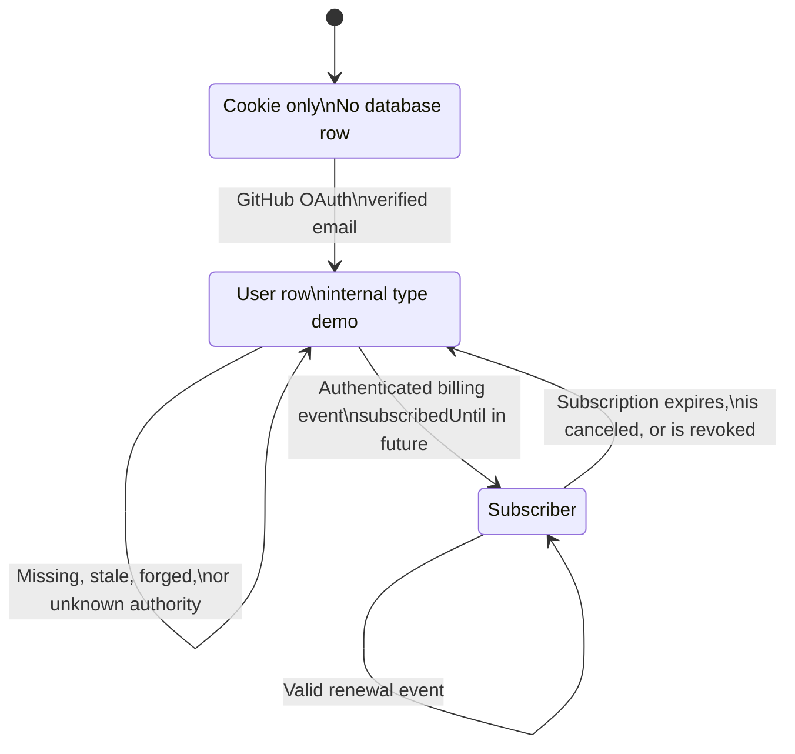
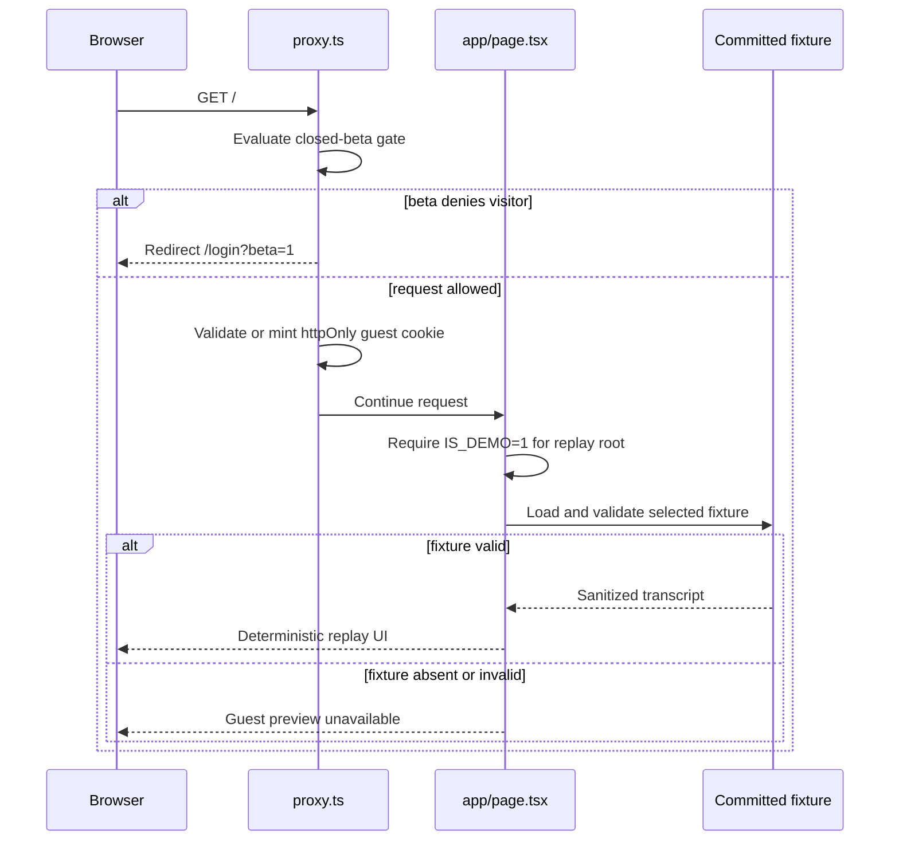
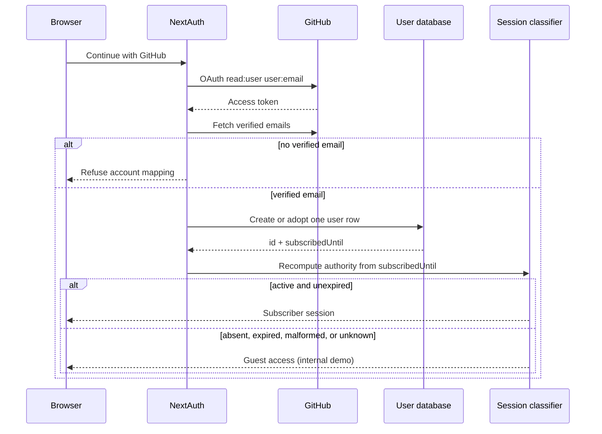
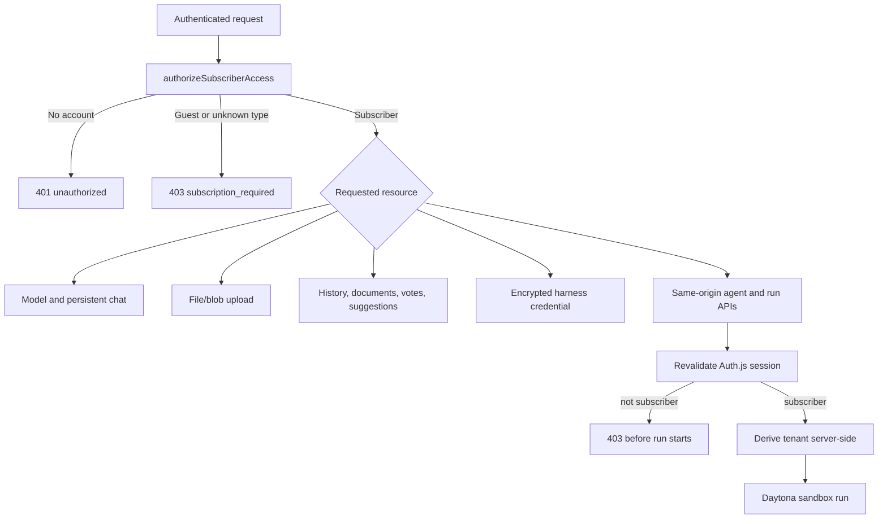

# Guest Access and Safety Boundary

- Status: living security and product contract
- Product term: **guest**
- Internal compatibility term: `demo`
- Applies to: public replay, GitHub account creation, subscription gating,
  same-origin runner APIs, and guest-facing copy

## Vocabulary

**Guest** is the user-facing name for a person who does not currently have an
active Coven Agents subscription. It includes:

- an anonymous visitor viewing the safe replay;
- a signed-in account whose subscription has never activated;
- a previously subscribed account whose authority has expired.

The internal `demo` label remains in database, session, token, environment,
cookie, module, and fixture identifiers:

- `User.type = "demo"`;
- `Session.kind = "demo"`;
- `RunnerClaims.plan = "demo"`;
- `IS_DEMO`, `DEMO_TRANSCRIPT`, and `coven-demo`;
- `lib/demo`, `components/demo`, and `OpenCoven/demo-workspace`.

Those names are compatibility contracts, not customer copy. Renaming them
requires a deliberate storage, cookie, environment, and wire-protocol
migration. New UI and living documentation must say **guest** unless they are
quoting one of those exact technical identifiers or a historical artifact.

Guest does not mean anonymous, fake, or disposable. A signed-in guest account
is a real product account with a stable user row. Guest means that live and
persistent product authority has not been granted.

## Guest states

| State | Identity and storage | Allowed purpose |
| --- | --- | --- |
| Anonymous guest | Server-minted httpOnly cookie; no user row | View the committed safe replay and choose whether to create an account |
| Signed-in guest | GitHub identity mapped to one local user row; internal type `demo` | Account access, generated avatar, usage/subscription status, and explicit checkout |
| Subscriber | Same account with server-authoritative active subscription | Credential custody, same-origin agent and run access, live runs, and persistent product features |
| Lapsed account | Existing user row; authority recomputed to internal type `demo` | Returns immediately to signed-in guest restrictions |

Creating a guest account is intentionally small, but it is not literally
zero-I/O: it performs GitHub OAuth, reads GitHub's verified-email endpoint, and
creates or adopts one local user row. It does **not** start an agent, sandbox,
run, credential flow, model request, file upload, or persistent chat.

## Flow diagrams

### State and authority transitions



Only an authenticated, ordered billing transition may enter `Subscriber`.
Every unknown or expired state resolves to guest access.

### Public guest replay



The replay tree contains no `fetch`, `SessionProvider`, NextAuth, database,
runner client, billing, or Git dependency. Missing data produces an unavailable
state; it never falls through to a live run.

### GitHub account creation and classification



GitHub authentication proves control of the GitHub identity. It does not grant
subscription authority, repository access, a harness credential, or runner
access.

### Resource-bearing request gate



The shared gate rejects guest claims without a database lookup. A session that
claims subscriber authority is then checked against the current server-owned
`subscribedUntil` value before database reads, uploads, model calls, credential
flows, or runner dispatch. The browser receives no connection secret or runner
identity token. The pure session decision lives in
`lib/auth/subscriber-access.ts`; the server-owned revalidation wrapper lives in
`lib/auth/subscriber-authorization.server.ts`.

## Authorization matrix

| Surface | Anonymous guest | Signed-in guest | Subscriber | Enforcement |
| --- | --- | --- | --- | --- |
| Safe replay at `/` when `IS_DEMO=1` | Allow | Allow | Allow | `lib/demo/root.ts`, fixture schema, route dependency regression |
| GitHub create/access | Allow | Already signed in | Already signed in | `app/(auth)/auth.ts`; verified email only |
| Generated avatar | Sign-in required | Allow without account-data read | Allow | `app/api/account/avatar/route.ts` |
| Custom avatar write | Deny | 403 | Allow | `databaseFor` plus subscriber check |
| Usage/subscription status | Deny | Allow minimal account read | Allow | `app/api/usage/route.ts` |
| Checkout | Deny until sign-in | Allow only after explicit user action | Conflict if already subscribed | `app/api/checkout/route.ts` |
| Live chat/model request | Deny | 403 before rate limit, model, or database work | Allow within limits | `lib/auth/subscriber-authorization.server.ts`, chat route |
| Chat history/messages/documents/votes/suggestions | Deny | 403 before database access | Allow with ownership checks | Shared subscriber gate in each route |
| File/blob upload | Deny | 403 before body or blob storage | Allow within file limits | Shared subscriber gate, upload schema |
| Harness credential list/write/delete/device flow | Deny | 403 | Allow | Credential routes and `databaseFor` |
| Agent and run APIs | Deny | Deny | Tenant-scoped | Same-origin session authorization |
| Legacy rollback Worker credential loan | No route authority | No route authority | Server-to-server only | Service token, verified legacy claim, subscriber plan |

The checkout and usage surfaces are narrow account-management exceptions. They
exist so a guest can understand and intentionally change their access. They
must not be reused as a general guest database path.

## Conditions and constraints

### Public replay conditions

- `IS_DEMO=1` makes the root route own the guest replay. Without it, `/`
  redirects to `/agents`.
- `DEMO_TRANSCRIPT` may select a committed fixture. Missing or invalid content
  renders a clear unavailable state.
- Fixtures are strict-schema, bounded, monotonically ordered, and sanitized in
  raw and canonical JSON.
- Recording is cloud-only and restricted to
  `OpenCoven/demo-workspace`.
- The replay CTA uses `prefetch={false}` so authentication resources are not
  loaded until the guest chooses account creation.

### Anonymous guest conditions

- `proxy.ts` sets only an httpOnly, same-site cookie containing a server-minted
  UUID.
- The cookie is secure outside development, scoped to `/`, and carries no
  email, GitHub token, subscription, or credential.
- Missing or malformed cookie values are replaced; visitors cannot choose a
  tenant identifier.
- The cookie provides request-to-request continuity but creates no database
  row.
- When closed beta is enabled, the beta decision runs before cookie issuance.
  An uninvited visitor is redirected to sign in rather than receiving guest
  access.

### Signed-in guest conditions

- GitHub is the only sign-in provider and requests identity scopes only:
  `read:user user:email`.
- The verified-email API, not the self-authored profile email, selects or
  creates the account.
- A signed-in guest has one local user row but no subscriber database handle.
- Subscription type is recomputed from the token's `subscribedUntil` on every
  token callback. Browser input cannot set `id`, `type`, or
  `subscribedUntil`.
- Resource-bearing routes revalidate subscriber-claiming tokens against the
  current database value. Guest claims are denied without that lookup, while a
  revoked subscriber token loses authority immediately.
- `lib/session.ts` maps the account into the fail-closed guest or subscriber
  session union used by downstream authorization.
- The exact internal subscriber value is required. Missing, expired,
  malformed, forged, or unknown values fail closed to guest access.
- A guest cannot store credentials, call same-origin agent or run APIs, call a
  model, upload a file, or read/write persistent chat data. No browser account
  receives a Worker deployment token or runner identity from the current app.
- `app/api/credentials/route.ts` and the same-origin agent/run routes enforce
  their product gates independently.

### Subscriber and downgrade conditions

- Billing provider events must be authenticated, idempotent, and order-safe.
- Downgrade takes effect when server-owned subscription authority expires, not
  when the browser token happens to expire.
- Previously stored credentials remain encrypted but cannot be borrowed by a
  guest claim.
- A lapsed account cannot start a run even if an old credential row exists.
  Same-origin agent and run routes reject its revalidated application session
  before execution. If the application is rolled back to the legacy Worker
  path, the Worker and retained internal credential endpoint independently
  reject a non-subscriber claim.

## Safety precautions

1. **Gate before cost or persistence.** Every new model, database, blob,
   credential, runner, or sandbox route must call
   `authorizeSubscriberAccess` before parsing a large body or touching the
   resource.
2. **Keep guest copy separate from internal compatibility.** Say guest in UI
   and living docs. Do not casually rename `demo` storage, cookie, environment,
   token, or module identifiers.
3. **Never infer authority from sign-in.** GitHub identity and subscription
   entitlement are separate decisions.
4. **Do not create success-shaped fallbacks.** Missing fixtures, keys,
   credentials, subscription state, or runner configuration must produce an
   explicit unavailable, unauthorized, or forbidden result.
5. **Keep replay isolated.** Do not add auth providers, network requests,
   database imports, runner clients, billing calls, or Git operations to the
   guest replay tree.
6. **Keep secrets out of guest-visible evidence.** Recorder output is redacted
   before publication; committed fixtures are scanned in raw and parsed form.
7. **Do not create browser runner credentials.** Current browser accounts use
   only their application session; no account receives a deployment gate or
   signed runner identity.
8. **Repeat checks across active trust boundaries.** Browser refusal is UX,
   not the security boundary. Same-origin routes revalidate session authority
   and server-owned tenant scope. The retained Worker and internal endpoint
   checks are additional rollback-only boundaries.
9. **Treat checkout as explicit consent.** Stripe work occurs only after the
   signed-in guest chooses upgrade; page load and account creation do not
   create a checkout session.
10. **Preserve privacy in errors.** Refusals state the missing authority without
    exposing credentials, other tenants, internal paths, or provider output.

## Operator checklist

Before publishing a guest deployment:

- set a nonempty `AUTH_SECRET`;
- configure GitHub OAuth callback URLs and identity-only scopes;
- decide whether `BETA_MODE` should close the deployment and verify the
  allowlist;
- set `IS_DEMO=1` only on the deployment intended to serve the replay at `/`;
- verify the selected fixture exists and passes schema and secret scans;
- leave runner, credential, and billing secrets out of the guest deployment
  unless the same deployment also serves subscribers;
- confirm `/api/agents`, `/api/runs`, `/api/credentials`, `/api/chat`, and
  upload/persistence routes return 401 or 403 for non-subscribers;
- confirm the replay renders without auth, database, Worker, or network
  requests.

After suspected guest-boundary bypass:

1. disable the affected resource route or deployment;
2. rotate any exposed session, tenant credential, or active service secret;
   rotate Worker deployment or signing material only if the rollback runtime
   was involved;
3. preserve sanitized request identity and operation metadata;
4. add the bypass as a regression before restoring access;
5. follow [Security incident response](incident-response.md).

## Verification

| Guarantee | Evidence |
| --- | --- |
| Replay stays static and isolated | `scripts/demo-route.test.ts`, `lib/demo/*.test.ts`, `lib/demo/fixtures.test.ts` |
| Guest terminology stays user-facing | `scripts/demo-route.test.ts`, authentication browser test, account menu assertions |
| Subscriber classification fails closed | `lib/session.test.ts`, `lib/subscription.test.ts`, `lib/session-claims.test.ts` |
| Resource routes share one gate | `lib/auth/subscriber-access.test.ts`, `lib/auth/subscriber-authorization.test.ts`, `scripts/guest-access-docs.test.ts` |
| Guest cannot store a credential | `lib/credentials/authorize.test.ts`, credential route tests |
| Guest cannot reach runner execution | same-origin agent/run route tests and browser boundary regression |
| Legacy rollback Worker refuses guest execution | `worker/src/routes.test.ts`, internal credential binding tests |
| Guest fixtures contain no recognized secrets | `lib/demo/fixtures.test.ts`, `scripts/secret-scan.test.ts` |

The still-deployed rollback Worker keeps its independent enforcement in
`worker/src/routes.ts`; its internal authority and credential calls remain
server-to-server until that boundary moves atomically.

Run the full repository gates before merging a guest-boundary change:

```bash
pnpm hygiene
pnpm secret:scan:all
pnpm check
pnpm typecheck
pnpm test:unit
pnpm build
```
