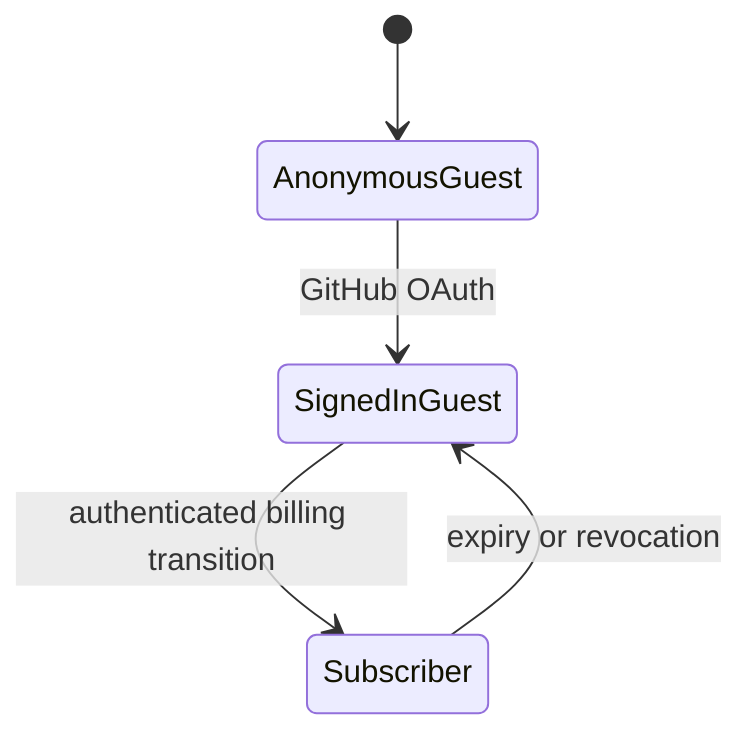
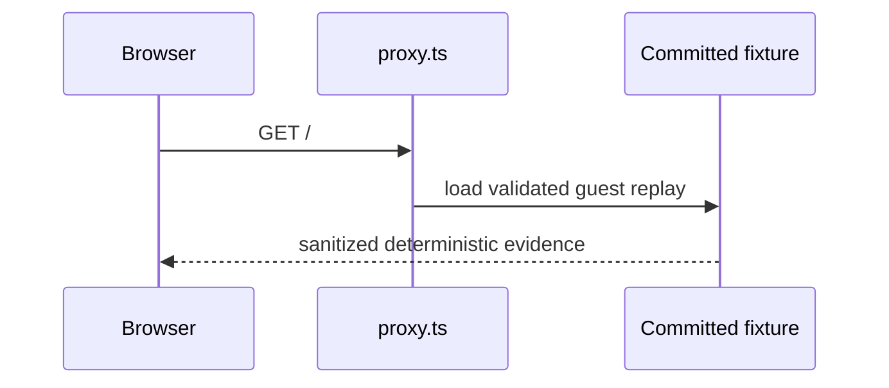
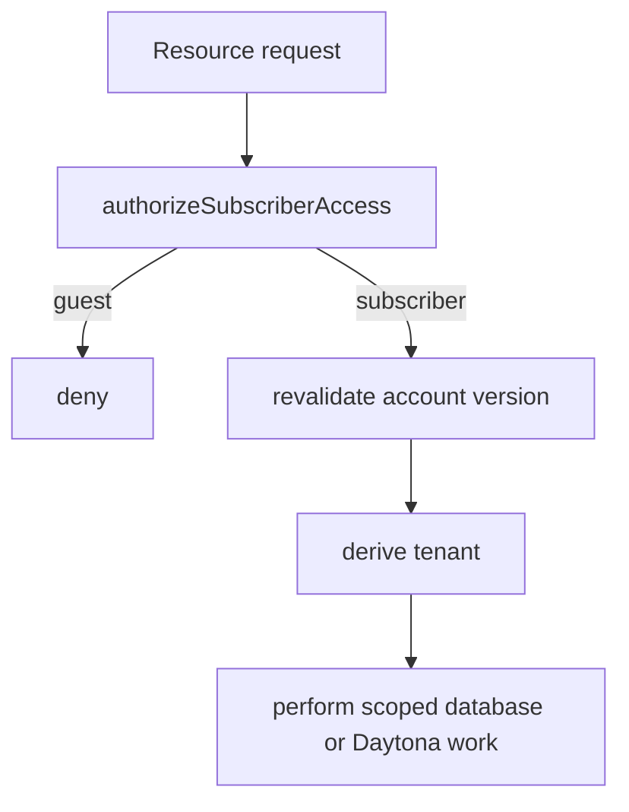

# Guest Access and Safety Boundary

- Status: living security and product contract
- Product term: **guest**
- Internal compatibility term: `demo`

## Vocabulary

Guest access applies to anonymous visitors and signed-in accounts without an
active subscription. The internal `demo` identifier remains in existing
storage, cookie, environment, and module contracts; user-facing copy says
**guest**.

GitHub sign-in proves identity, not subscription authority. A guest account is
a real product account with no live execution or persistent product authority.

## Guest states

| State | Storage | Allowed purpose |
| --- | --- | --- |
| Anonymous guest | httpOnly continuity cookie; no user row | View the safe replay and choose sign-in |
| Signed-in guest | One product user row | Account, usage status, and explicit checkout |
| Subscriber | Server-owned active subscription | Credentials, persistent product data, and Daytona execution |
| Lapsed account | Existing user row | Immediate return to guest restrictions |

Account creation does **not** start an agent, sandbox, run, credential flow,
model request, upload, or persistent chat.

## Flow diagrams

`proxy.ts` handles entry policy and the continuity cookie.
`app/(auth)/auth.ts` creates or adopts the GitHub account.
`lib/session.ts` maps server-owned state into guest or subscriber sessions.
`lib/auth/subscriber-access.ts` provides the pure decision.
`lib/auth/subscriber-authorization.server.ts` performs authoritative
revalidation.

## Authorization matrix

| Surface | Anonymous guest | Signed-in guest | Subscriber |
| --- | --- | --- | --- |
| Safe committed replay | Allow | Allow | Allow |
| Account and usage status | Sign-in required | Allow | Allow |
| Explicit checkout | Sign-in required | Allow | Already subscribed |
| Persistent chat and files | Deny | Deny | Allow within limits |
| Credential routes | Deny | Deny | Allow through `app/api/credentials/route.ts` |
| Agent and run APIs | Deny | Deny | Allow through `lib/runner/http.ts` |
| Provider dispatch | Deny | Deny | Rechecked by `lib/runner/runtime.ts` |

## Conditions and constraints

- Guest replay fixtures are committed, strict-schema, bounded, and sanitized.
- Replay rendering has no database, billing, credential, or Daytona dependency.
- GitHub verified email selects the account; profile email is not authority.
- Subscription is recomputed from server-owned state.
- A revoked subscriber token loses authority immediately when protected access
  revalidates the current account version.
- Request input cannot select tenant identity.
- The browser receives no provider configuration or harness plaintext.
- Missing identity, subscription, fixture, or configuration fails closed.

## Safety precautions

1. Call `authorizeSubscriberAccess` before cost, persistence, body-heavy work,
   credential access, or Daytona dispatch.
2. Keep guest copy separate from the internal `demo` identifier.
3. Never infer subscription from sign-in.
4. Keep the replay isolated from live services.
5. Redact guest-visible evidence in raw and parsed form.
6. Treat browser refusal as UX; repeat authorization at server boundaries.
7. Keep checkout an explicit user action.
8. Keep errors nondisclosing.

## Operator checklist

- Verify guest replay selection and schema validation.
- Confirm protected routes return 401 or 403 for non-subscribers.
- Confirm account creation does not allocate execution resources.
- Confirm subscriber downgrade is effective before credential or Daytona work.
- Confirm replay output contains no recognized secret.

## Verification

| Guarantee | Evidence |
| --- | --- |
| Replay isolation | `scripts/demo-route.test.ts`, `lib/demo/*.test.ts` |
| Guest terminology | `scripts/guest-access-docs.test.ts` |
| Fail-closed classification | `lib/session.test.ts`, `lib/subscription.test.ts` |
| Shared route gate | `lib/auth/subscriber-authorization.test.ts` |
| Credential refusal | credential authorization and route tests |
| Execution refusal | same-origin agent/run route tests |
| Dispatch-time revalidation | `lib/runner/runtime.test.ts` |
